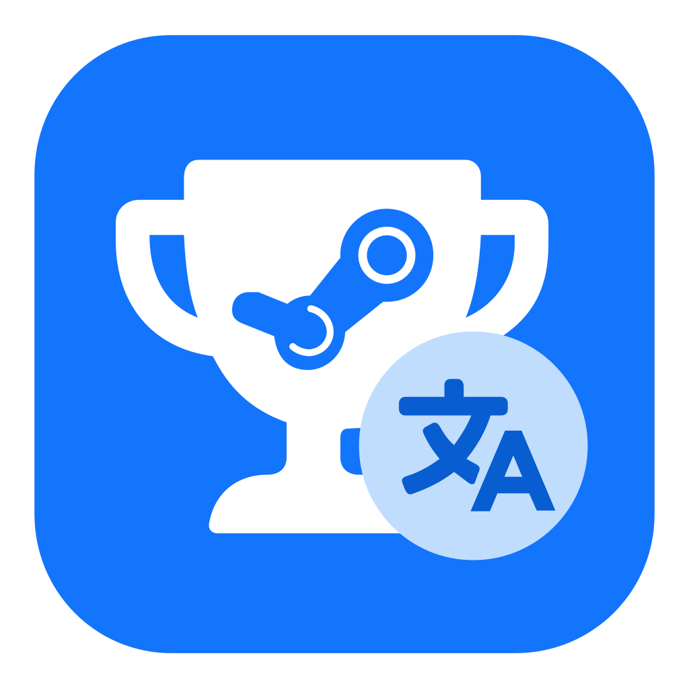

  

<h1 align="center">SATLI</h1>

  <strong>Steam 成就翻译管理器</strong> 
  Steam Achievement Translation &amp; Localization Integrator

  在 Windows 上获取、导入、编辑、安装、恢复和管理 Steam 成就翻译。

  
  
  

  

  <a href="docs/USAGE.md">📖 使用指南</a>
  ·
  <a href="https://github.com/GaBoron/SATLI/issues/new/choose">💬 反馈问题</a>
  ·
  <a href="https://www.ifdian.net/a/gaboron">❤️ 赞助开发者</a>
  ·
  <a href="mailto:SATLI.support@proton.me">📧 获取支持</a>

> [!IMPORTANT]
> **Steam 更新后，直接替换本地 `.bin` 成就缓存的方式已不稳定**，修改可能被 Steam 重新获取的成就数据覆盖，无法保证译文始终生效。
>
> 如果只需在 Steam 中显示社区译文，**建议优先使用 [SATLI lite](https://github.com/GaBoron/SATLI-lite)**。它通过 Millennium 插件替换显示文字，无需改写本地 `.bin`。制作和校对译文、导出投稿文件或管理 BIN 时，可使用本项目的桌面版。
>
> **你也可以继续使用本软件通过桥接使用 SATLI lite 功能。**

## 快速开始

1. 打开应用，等待它扫描本机 Steam 游戏。
2. 在“云端”页点击游戏的“安装”，选择译本、语言和安装方式；本机已发现的游戏也可从“可管理”页进入。
3. 有 JSON 时可首次直接选择“JSON（lite）”；有 BIN 时也可独立选择“BIN”。

BIN 安装会在确认后关闭 Steam、校验译本并备份原文件。JSON 路线只向 lite 的公开本机接口导入译文并读取结果，不写入 Steam BIN；浏览、下载和预览不要求安装插件。首次安装 lite 或写入受保护目录时会请求管理员权限。

也可先打开“设置 → Steam 译文显示 → 安装 / 管理 SATLI-lite”。SATLI 仅从 lite 官方正式 Release 下载插件，已有安装由 lite 自身更新；Millennium 需按官方指南另行安装。

> [!TIP]
> 找不到游戏时，请先启动一次游戏，让 Steam 生成成就缓存，再返回应用重新扫描。

## 核心能力

| | 能力 | 说明 |
| --- | --- | --- |
| 🔎 | 自动发现 | 扫描 Steam 目录和本机成就缓存，支持按名称或 App ID 搜索 |
| 🛡️ | 安全安装 | 安装前预览与校验，自动备份，支持批量安装、状态检查和安全恢复 |
| 🔒 | JSON 显示管理 | 浏览 BIN+JSON 与 JSON-only 译本，按需安装 SATLI-lite、发送译文并查询真实状态，SATLI 无需后台运行 |
| ✍️ | 翻译制作 | 从公开数据或 JSON 创建无 BIN 工程，手动编辑或生成 AI 参考译文，校对后导出与投稿；保留本地 BIN 编辑能力 |
| ☁️ | 社区协作 | 获取社区译本、请求新翻译、贡献成果，并报告过期或无效文件 |
| 🌐 | 稳定连接 | 支持离线缓存、系统代理、HTTP/SOCKS 代理、自定义 DNS 与镜像 |

社区译本和本地导入使用同一套校验、备份与恢复流程。详细操作见 [使用指南](docs/USAGE.md)。

## 系统要求

- Windows 10 版本 2004（Build 19041）或更高版本，推荐 Windows 11
- x64 处理器
- 已安装 Steam；使用离线缓存时可暂时不联网

无需手动安装依赖运行库。Microsoft Store 会自动处理商店版的依赖；独立安装器会在需要时联网补齐微软运行库。

## 请求或贡献翻译

- **没有现成译本：** 在应用中点击“未找到游戏？”，导出原始 schema ZIP，并前往翻译库提交翻译请愿。
- **已经完成翻译：** 从编辑页导出独立翻译 JSON 或标准投稿 ZIP，再通过翻译库的投稿入口提交；导出 JSON 无需先写回 Steam。
- **希望使用 Codex 制作：** 打开 [Steam Achievement Localizer Skill](https://github.com/GaBoron/steam-achievement-localizer-skill)，完成翻译后将其 `final/` 目录导入管理器。

详细流程和文件要求见 [制作、导入与贡献翻译](docs/USAGE.md#制作导入与贡献翻译)。

## 项目生态

以下项目提供 Steam 成就译本的制作、分发和使用工具：

| 项目 | 定位 | 适合场景 |
| --- | --- | --- |
| **Steam 成就翻译管理器**（当前项目） | Windows 图形化客户端 | 查找、安装、编辑和恢复翻译 |
| [SATLI lite](https://github.com/GaBoron/SATLI-lite) | 独立 Millennium 插件 | 在 Steam 内下载、切换、编辑和显示社区译本 |
| [Steam 成就翻译库](https://github.com/GaBoron/steam-achievement-translation-library) | 社区翻译数据仓库 | 查找、请求、提交和维护译本 |
| [Steam Achievement Localizer Skill](https://github.com/GaBoron/steam-achievement-localizer-skill) | Codex 翻译与审核工作流 | 研究多语言语境并制作可验证译本 |

## 文档

| 文档 | 内容 |
| --- | --- |
| [使用指南](docs/USAGE.md) | 安装、编辑、恢复、投稿、网络设置与常见问题 |
| [数据与隐私](docs/PRIVACY.md) | 本地数据、凭据、日志和网络请求说明 |
| [第三方声明](THIRD_PARTY_NOTICES.md) | 随软件分发的第三方组件和权利说明 |

## 联系与支持

遇到使用问题时，可通过 [GitHub Issues](https://github.com/GaBoron/SATLI/issues/new/choose) 反馈，或发送邮件至 [SATLI.support@proton.me](mailto:SATLI.support@proton.me)。

## 许可证

程序代码采用 [MIT License](LICENSE)。第三方组件和翻译数据的权利说明见 [第三方声明](THIRD_PARTY_NOTICES.md)。
